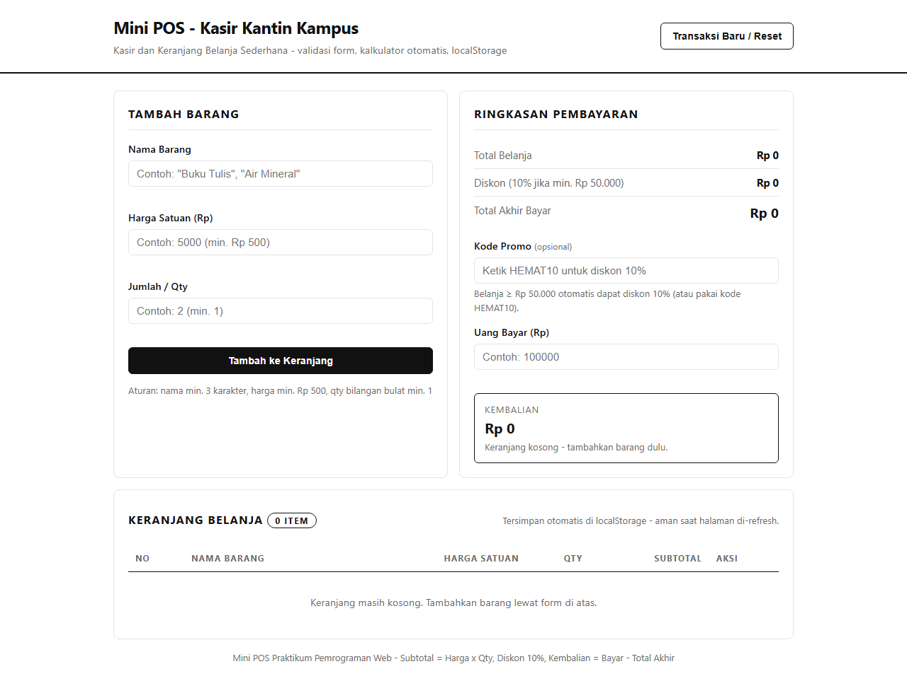
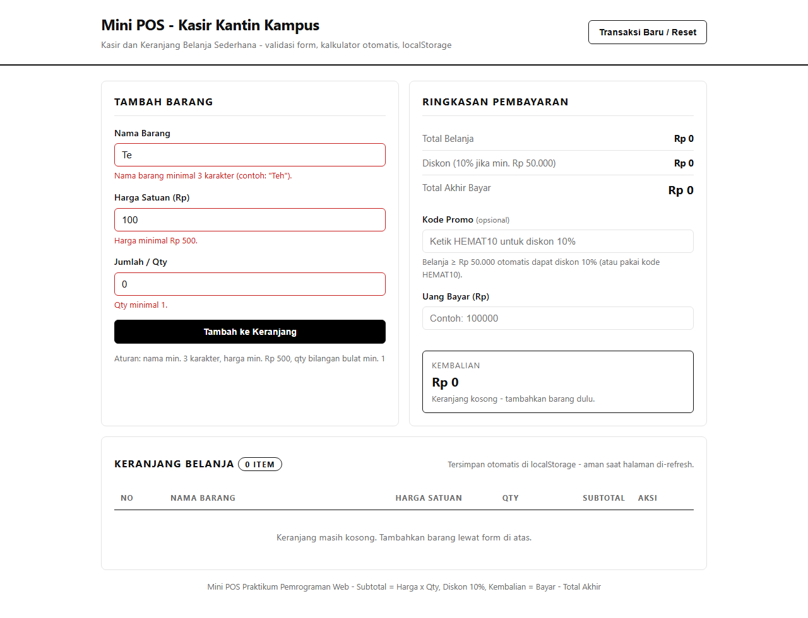
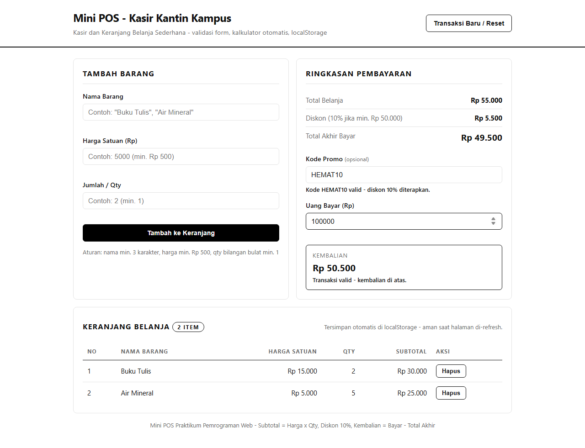

# Mini POS - Kasir & Keranjang Belanja Sederhana (Kantin / Toko Kampus)

## 1. Identitas

- **Nama Lengkap:** Jeremi Pison Efrat Sianturi
- **NIM:** 124140195
- **Kelas Praktikum:** RB
- **Repository:** `pemrograman_web_itera_124140195`
- **Folder Tugas:** `jeremipisoncfratsianturi_124140195_pertemuan1`

## 2. Deskripsi Aplikasi

Aplikasi web **Mini POS** untuk kasir kantin / toko kampus. Tujuan pembuatan adalah menyatukan tiga
kompetensi dasar praktikum dalam satu alur transaksi yang realistis:

1. **Validasi input form** agar data barang yang masuk keranjang selalu benar.
2. **Kalkulator otomatis** untuk subtotal, total, diskon, total akhir, dan kembalian.
3. **Manajemen keranjang + localStorage** agar data belanja persisten saat refresh.

Studi kasus yang dipilih: kasir menginput barang jualan kantin (contoh: "Air Mineral", "Buku Tulis"),
sistem menghitung total + diskon, kasir menginput uang bayar, sistem menampilkan kembalian,
lalu transaksi bisa di-reset untuk pembeli berikutnya.

## 3. Panduan Menjalankan

Tidak butuh build / install apa pun (HTML + CSS + JS murni).

**Cara 1 - Klik ganda (paling cepat):**

1. Buka folder `jeremipisoncfratsianturi_124140195_pertemuan1`.
2. Klik ganda `index.html` → terbuka di browser.

**Cara 2 - Live Server VS Code (disarankan):**

1. Buka folder repo di VS Code.
2. Install extension **Live Server** (Ritwick Dey).
3. Klik kanan `index.html` → **Open with Live Server**.
4. Aplikasi terbuka di `http://127.0.0.1:5500/...`.

## 4. Daftar Fitur (Checklist)

### Validasi Form & Error Handling (20%)

- [x] Nama barang wajib, minimal 3 karakter.
- [x] Harga satuan angka positif, minimal Rp 500 (tolak 0, negatif, kosong, teks).
- [x] Qty bilangan bulat minimal 1 (tolak 0, negatif, desimal, kosong).
- [x] Pesan merah di bawah input yang salah (`.error-msg`).
- [x] Barang gagal masuk keranjang jika tidak valid; form auto-reset jika sukses.

### Kalkulator & Perhitungan (30%)

- [x] Subtotal per baris: `Harga × Qty`.
- [x] Total belanja: jumlah seluruh subtotal (otomatis).
- [x] Diskon 10% otomatis jika total ≥ Rp 50.000.
- [x] Kode promo `HEMAT10` (case-insensitive): memperkuat diskon; kode salah → tidak ada diskon + pesan error.
- [x] Tampil nominal diskon + total akhir bayar.
- [x] Input Uang Bayar → kembalian `Bayar − Total Akhir` realtime; jika kurang tampil "Uang belum mencukupi".

### List & LocalStorage (30%)

- [x] Tabel keranjang: No, Nama, Harga Satuan, Qty, Subtotal, Aksi.
- [x] Tombol Hapus per baris → total & diskon hitung ulang otomatis.
- [x] Persisten via `JSON.stringify()` (simpan) & `JSON.parse()` (muat) di `localStorage` key `minipos_cart_v1`.
- [x] Tombol Transaksi Baru / Reset → kosongkan keranjang + bersihkan localStorage (dengan konfirmasi).

### UI/UX (10%) + Struktur Kode (10%)

- [x] Layout 2 kolom (form + ringkasan), tabel full-width, responsif <768px jadi 1 kolom.
- [x] Format Rupiah `Rp xx.xxx` di semua angka via `toLocaleString('id-ID')`.
- [x] Pisah file `index.html` / `style.css` / `script.js`, fungsi bernama jelas, folder `modul/`.

## 5. Tangkapan Layar (Screenshot)

Simpan 3 file berikut di folder `screenshots/`:

| # | File | Isi |
|---|------|-----|
| 1 | `screenshots/01-form-utama.png` | Tampilan form input utama + tabel kosong |
| 2 | `screenshots/02-validasi-error.png` | Pesan merah saat nama <3 char / harga <500 / qty <1 |
| 3 | `screenshots/03-hasil-kalkulator-tabel.png` | Keranjang terisi + diskon + kembalian |

> Cara ambil: jalankan aplikasi → tekan `Win+Shift+S` / buka DevTools → simpan ke folder di atas.
> Placeholder sudah disiapkan; ganti dengan screenshot asli sebelum pengumpulan.





## 6. Penjelasan Teknis Singkat

**Validasi input** (`validateNama/Harga/Qty` di `script.js`):

- `submit` → tiap field divalidasi jadi string error atau `''`.
- `tampilkanError()` menulis pesan ke `<small>` + class `.invalid` (border merah).
- Jika ada satu saja error → `return` (barang tidak di-push). Jika lolos → `push` + `form.reset()`.

**Algoritma kalkulator:**

```text
subtotal[i] = harga[i] × qty[i]
total       = Σ subtotal
diskon      = total ≥ 50000 AND (promo kosong ATAU promo == HEMAT10) ? 10% × total : 0
totalAkhir  = total − diskon
kembalian   = uangBayar − totalAkhir  (< 0 → "belum mencukupi")
```

`recalcRingkasan()` dipanggil setiap `renderCart()` dan setiap `input` pada kode promo / uang bayar,
sehingga semua angka selalu sinkron.

**Serialisasi localStorage:**

- Simpan: `localStorage.setItem(KEY, JSON.stringify(cart))` setiap selesai render/hapus/tambah.
- Muat: `JSON.parse(localStorage.getItem(KEY))` saat `DOMContentLoaded`, dibungkus `try/catch` +
  filter sanitasi agar data rusak tidak merusak render.
- Reset: `cart = []` + `renderCart()` (yang otomatis menimpa storage) setelah `confirm()`.

## 7. Struktur File

```text
jeremipisoncfratsianturi_124140195_pertemuan1/
├── index.html
├── style.css
├── script.js
├── README.md
├── modul/
│   └── latihan1.html
└── screenshots/
    ├── 01-form-utama.png
    ├── 02-validasi-error.png
    └── 03-hasil-kalkulator-tabel.png
```
