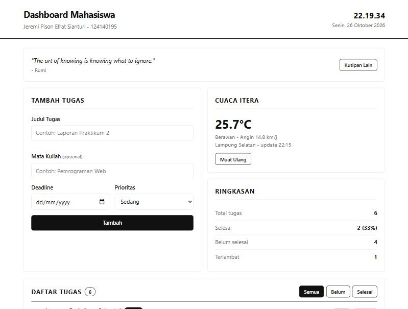
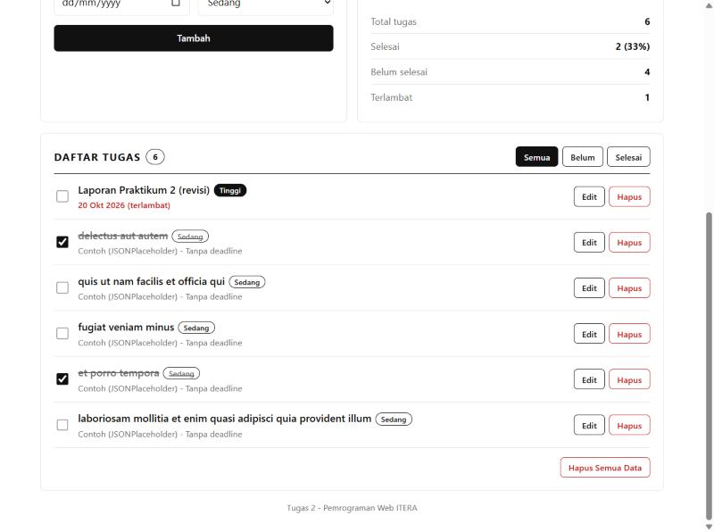
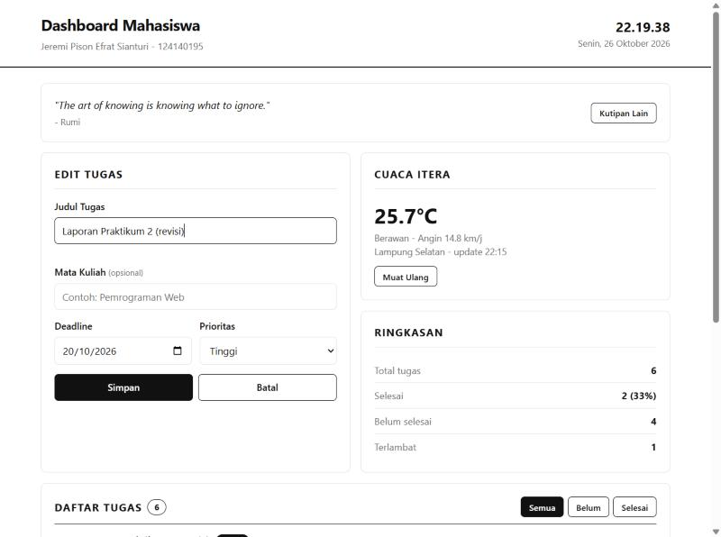

# Dashboard Mahasiswa - Personal Dashboard

## 1. Identitas

- **Nama Lengkap:** Jeremi Pison Efrat Sianturi
- **NIM:** 124140195
- **Kelas Praktikum:** RB
- **Repository:** `pemrograman_web_itera_124140195`
- **Folder Tugas:** `jeremipisonefratsianturi_124140195_pertemuan2`

## 2. Deskripsi Aplikasi

**Dashboard Mahasiswa** dipakai untuk mencatat tugas kuliah beserta mata kuliah dan deadline-nya,
melihat tugas mana yang sudah terlambat, serta mengecek jam dan cuaca di kampus ITERA.

### Fitur

| Fitur | Keterangan |
|-------|------------|
| Jam & tanggal | Jam realtime (update tiap detik) di header |
| Kutipan harian | Diambil dari DummyJSON, tombol **Kutipan Lain** untuk ganti |
| Cuaca ITERA | Suhu, kondisi, & angin dari Open-Meteo (Lampung Selatan), tombol **Muat Ulang** |
| Tambah tugas | Judul (wajib, min. 3 karakter), mata kuliah, deadline, prioritas |
| Edit tugas | Tombol **Edit** mengisi form; tombol **Simpan** / **Batal** |
| Hapus tugas | Per item (dengan konfirmasi) atau **Hapus Semua Data** |
| Tandai selesai | Checkbox, judul dicoret |
| Filter | Semua / Belum / Selesai + jumlah item |
| Ringkasan | Total, selesai (%), belum selesai, terlambat |
| Deadline terlambat | Ditandai merah "(terlambat)" |
| localStorage | Data tersimpan di key `dashboard_tasks_v1`, tetap ada setelah refresh |
| Data awal | Saat pertama dibuka (storage kosong), 5 tugas contoh diambil dari JSONPlaceholder |

## 3. Cara Menjalankan

Tanpa build / install (HTML + CSS + JS murni). Butuh internet untuk cuaca, kutipan, dan data awal.

1. Buka folder ini di VS Code, klik kanan `index.html`, pilih **Open with Live Server**, atau
2. Klik ganda `index.html` untuk membuka langsung di browser.

## 4. Screenshot

Screenshot tersimpan di folder `screenshots/`:

| # | File | Isi |
|---|------|-----|
| 1 | `screenshots/01-dashboard.jpg` | Tampilan utama (header, kutipan, form, cuaca, ringkasan) |
| 2 | `screenshots/02-daftar-tugas.jpg` | Daftar tugas dengan tugas selesai, terlambat, dan badge prioritas |
| 3 | `screenshots/03-edit-tugas.jpg` | Form dalam mode Edit |





## 5. Fitur ES6+ yang Diimplementasikan

Semua baris mengacu ke file `script.js`.

| Fitur ES6+ | Baris | Penjelasan |
|------------|-------|------------|
| `const` | 4, 5, 12, 80, 293-295 | Konstanta & nilai yang tidak di-assign ulang |
| `let` | 183 | `pesanError` diubah sesuai hasil validasi |
| Arrow functions | 12, 14, 17, 19, 22, 134, 150, 227-252 | Helper (`$`, `escapeHtml`, `formatTanggal`, `weatherLabel`), callback `map/filter`, event listener |
| Template literals | 112, 124-127, 268-282, 302 | Render kutipan, cuaca, item tugas, ringkasan |
| Async / Await | 65, 94-104, 107-116, 118-131 | `init()`, `seedTasks()`, `fetchQuote()`, `fetchWeather()` dengan `fetch` + `try/catch` |
| Classes | 33 (`TaskItem`), 58 (`DashboardApp`) | Model item tugas & pengelola state, localStorage, fetch |
| Destructuring | 34, 99, 111, 123, 202, 245, 267, 302 | Parameter constructor, respons API, parameter `renderTask` |
| Spread operator | 45, 145, 150 | Update array/objek secara immutable |
| Default parameter | 34 | Nilai default `matkul`, `prioritas`, `selesai`, dll. |
| Getter & static method | 48, 52, 261 | `isOverdue`, `TaskItem.fromJSON`, `visibleTasks` |
| Nullish coalescing `??` | 72 | Pakai data awal hanya jika storage kosong |

## 6. Pengelolaan Data (localStorage)

- **Muat:** `JSON.parse(localStorage.getItem(KEY))` lalu di-`map` ke `TaskItem` (baris 78-86), dibungkus `try/catch`.
- **Simpan:** `localStorage.setItem(KEY, JSON.stringify(tasks))` (baris 90) dipanggil setiap tambah/edit/hapus/toggle lewat `commit()`.
- **State immutable:** `addTask`, `updateTask`, `deleteTask`, `toggleTask` selalu membuat array baru (spread / `map` / `filter`), tidak mengubah array lama.

## 7. Struktur File

```text
jeremipisonefratsianturi_124140195_pertemuan2/
├── index.html
├── style.css
├── script.js
├── README.md
└── screenshots/
```
