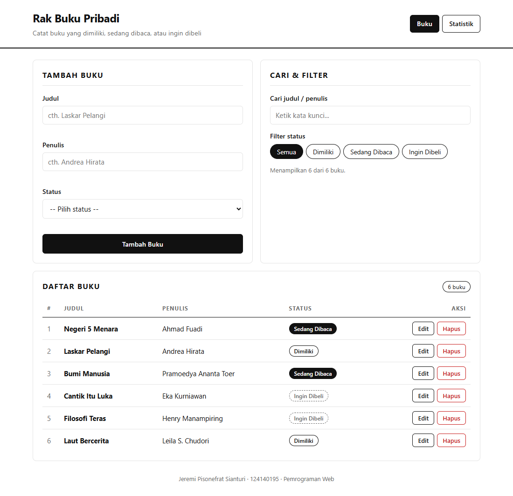
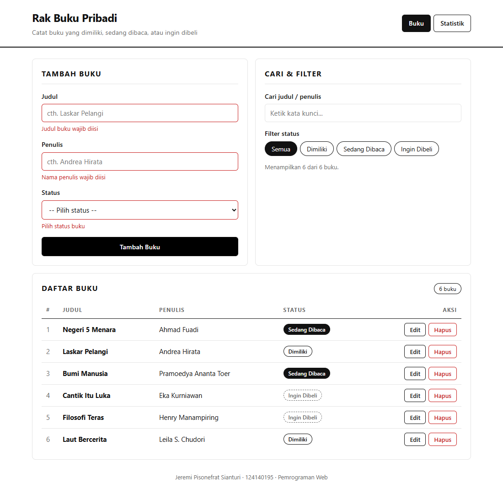
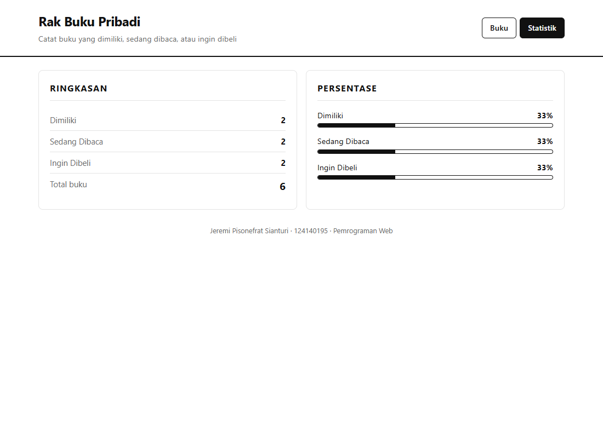
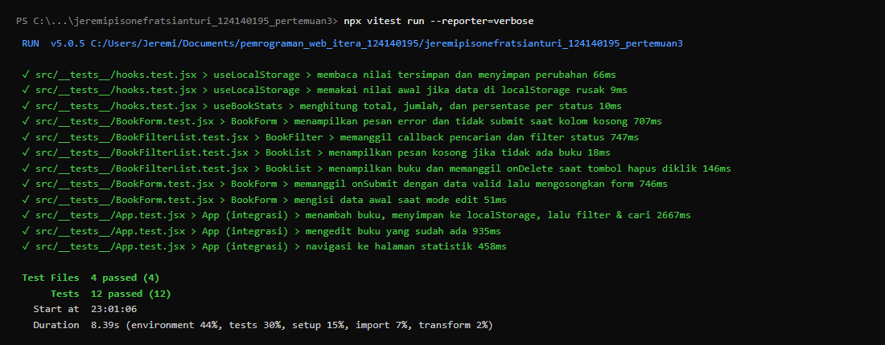

# Rak Buku Pribadi — Aplikasi Manajemen Buku

**Nama:** Jeremi Pisonefrat Sianturi
**NIM:** 124140195
**Mata Kuliah:** Pemrograman Web — Pertemuan 3

## Deskripsi

Aplikasi React untuk mencatat buku pribadi: buku yang **dimiliki**, **sedang dibaca**, atau **ingin dibeli**. Pengguna dapat menambah, mengedit, menghapus, mencari, dan memfilter buku. Data tersimpan di `localStorage` sehingga tetap ada setelah halaman di-refresh. Tampilan dibuat minimalis hitam-putih, mengikuti gaya tugas 1.

## Instalasi & Menjalankan

```bash
npm install      # pasang dependensi
npm run dev      # jalankan di http://localhost:5173
npm test         # jalankan unit test (Vitest + React Testing Library)
npm run build    # build produksi
```

## Fitur

- Tambah buku (judul, penulis, status: milik / baca / beli)
- Edit & hapus buku (dengan konfirmasi)
- Filter berdasarkan status
- Pencarian berdasarkan judul atau nama penulis
- Halaman **Statistik**: jumlah & persentase buku per status
- Validasi form: kolom wajib isi, border merah + pesan error jika kosong
- Penyimpanan persisten dengan `localStorage`

## Struktur Folder

```
src/
├── components/
│   ├── BookForm/      form tambah/edit + validasi
│   ├── BookList/      tabel daftar buku
│   ├── BookItem/      satu baris buku (+ bookShape PropTypes)
│   ├── BookFilter/    pencarian & filter status
│   └── StatusBadge/   badge status
├── pages/
│   ├── Home/          halaman utama (form, filter, daftar)
│   └── Stats/         halaman statistik
├── hooks/
│   ├── useLocalStorage.js
│   └── useBookStats.js
├── context/
│   ├── BookContext.jsx
│   └── statusList.js
├── __tests__/         unit test
├── App.jsx            layout + routing
└── main.jsx           entry (BrowserRouter + BookProvider)
```

## Fitur React yang Digunakan

| Konsep | Penerapan |
| --- | --- |
| `useState` | state form, error validasi, kata kunci pencarian, filter status, buku yang sedang diedit |
| `useEffect` | sinkronisasi ke `localStorage`, mengisi form saat mode edit, mengubah judul tab |
| `useMemo` | menghitung statistik di `useBookStats` hanya saat data berubah |
| Context API | `BookContext` menyediakan `books`, `addBook`, `updateBook`, `deleteBook` ke semua halaman lewat hook `useBooks()` |
| React Router | `/` (Buku), `/stats` (Statistik), dan halaman 404; navigasi dengan `NavLink` |
| Custom hooks | `useLocalStorage` (state persisten, aman dari data rusak) dan `useBookStats` (statistik) |
| Komponen reusable | `BookForm`, `BookList`, `BookItem`, `BookFilter`, `StatusBadge` |
| PropTypes | semua komponen memiliki `propTypes` (termasuk `bookShape` yang dipakai ulang) |

## Screenshot

| Halaman | Gambar |
| --- | --- |
| Halaman utama |  |
| Validasi form |  |
| Statistik |  |

## Laporan Testing

12 test dalam 4 file (`src/__tests__/`):

- **BookForm** — error saat kolom kosong, submit data valid, mode edit
- **BookFilter / BookList** — callback pencarian & filter, pesan kosong, tombol hapus
- **Hooks** — `useLocalStorage` (baca/simpan & data rusak), `useBookStats` (hitung statistik)
- **App (integrasi)** — tambah + filter + cari, edit buku, navigasi ke statistik



```
 Test Files  4 passed (4)
      Tests  12 passed (12)
```
