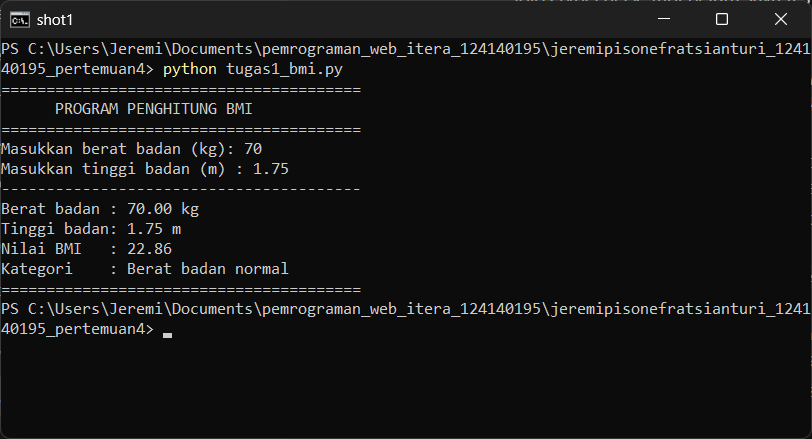
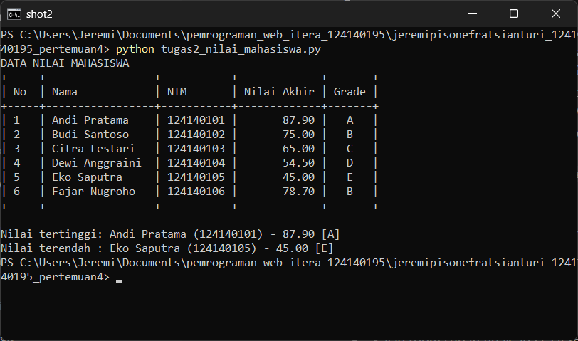
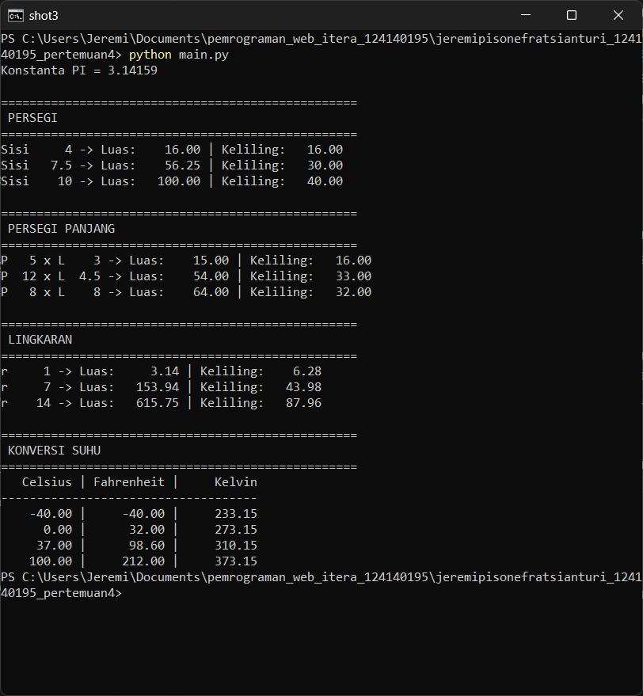

# Dasar Pemrograman Python

**Nama:** Jeremi Pisonefrat Sianturi
**NIM:** 124140195
**Mata Kuliah:** Pemrograman Web — Pertemuan 4

## Struktur Folder

```
jeremipisonefratsianturi_124140195_pertemuan4/
├── .gitignore
├── README.md
├── tugas1_bmi.py
├── tugas2_nilai_mahasiswa.py
├── math_operations.py
├── main.py
└── screenshots/
```

## Deskripsi Program

### Soal 1 — Penghitung BMI (`tugas1_bmi.py`)
1. Pengguna memasukkan berat badan (kg) dan tinggi badan (m) lewat `input()`. Fungsi `input_angka_positif()` mengulang input sampai nilainya angka positif.
2. `hitung_bmi()` menghitung `BMI = berat / (tinggi * tinggi)`.
3. `kategori_bmi()` menentukan kategori dengan `if-elif-else`: kurang (< 18.5), normal (18.5–< 25), berlebih (25–< 30), obesitas (≥ 30).
4. Nilai BMI dicetak dengan 2 angka desimal memakai f-string, beserta kategorinya.

### Soal 2 — Pengelolaan Nilai Mahasiswa (`tugas2_nilai_mahasiswa.py`)
1. `data_mahasiswa` adalah list berisi 6 dictionary dengan kunci `nama`, `nim`, `nilai_uts`, `nilai_uas`, `nilai_tugas`.
2. `hitung_nilai_akhir()` menghitung `30% UTS + 40% UAS + 30% Tugas`.
3. `tentukan_grade()` memberi grade A (≥ 80), B (70–79), C (60–69), D (50–59), E (< 50).
4. `proses_data()` menambahkan nilai akhir dan grade ke setiap dictionary, lalu `tampilkan_tabel()` mencetak tabel rapi dengan perataan f-string.
5. `cari_tertinggi()` dan `cari_terendah()` memakai `max()`/`min()` untuk menampilkan mahasiswa dengan nilai akhir tertinggi dan terendah.

### Soal 3 — Modul Matematika (`math_operations.py` & `main.py`)
- `math_operations.py` berisi konstanta `PI = 3.14159`, fungsi luas & keliling untuk persegi, persegi panjang, dan lingkaran, serta konversi suhu `celsius_ke_fahrenheit()` dan `celsius_ke_kelvin()`.
- `main.py` mengimpor modul dengan tiga cara berbeda:
  - `import math_operations` — dipakai untuk fungsi persegi
  - `import math_operations as mo` — dipakai untuk fungsi persegi panjang
  - `from math_operations import ...` — dipakai untuk `PI`, fungsi lingkaran, dan konversi suhu

  Setiap fungsi diuji dengan beberapa nilai, lalu hasilnya ditampilkan per bagian dengan format rata kanan.

## Cara Menjalankan

Masuk ke folder tugas terlebih dahulu:

```bash
cd jeremipisonefratsianturi_124140195_pertemuan4
```

```bash
python tugas1_bmi.py
```

```bash
python tugas2_nilai_mahasiswa.py
```

```bash
python main.py
```

## Screenshot Hasil Eksekusi

### Soal 1 — BMI


### Soal 2 — Nilai Mahasiswa


### Soal 3 — Modul Matematika

