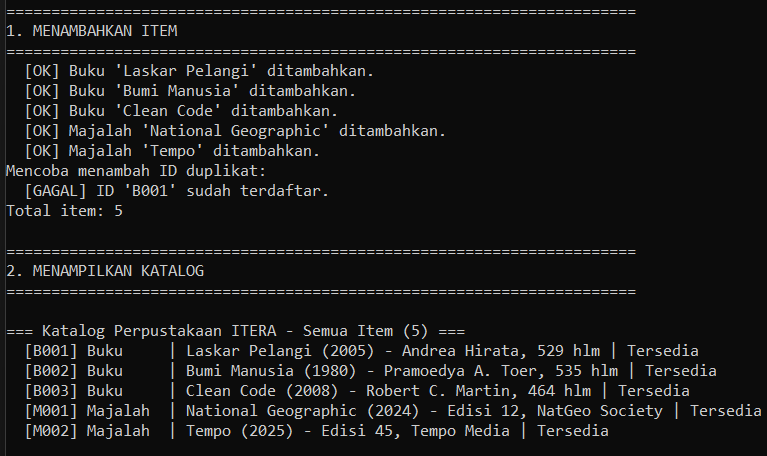
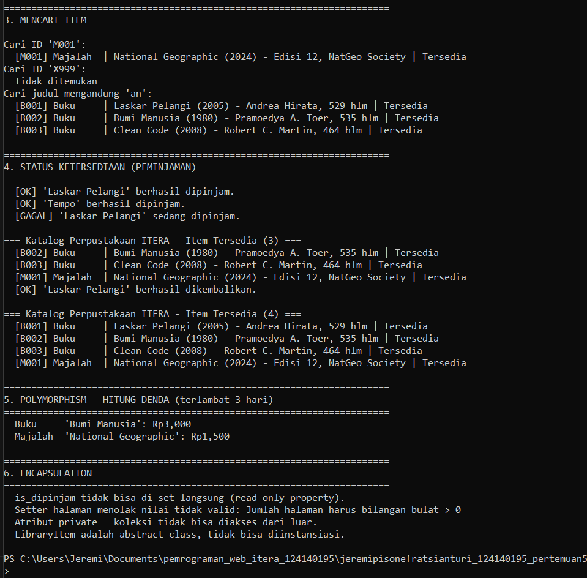

# Sistem Manajemen Perpustakaan Sederhana (OOP Python)

## 1. Identitas

- **Nama Lengkap:** Jeremi Pison Efrat Sianturi
- **NIM:** 124140195
- **Kelas Praktikum:** RB

## 2. Deskripsi Program

Program konsol untuk mengelola koleksi perpustakaan (buku dan majalah). Alur `main.py`:

1. Membuat objek `Library` lalu menambahkan 3 buku dan 2 majalah (termasuk percobaan ID duplikat yang ditolak).
2. Menampilkan katalog semua item.
3. Mencari item berdasarkan ID dan berdasarkan kata kunci judul.
4. Meminjam dan mengembalikan item, lalu menampilkan katalog yang hanya berisi item tersedia.
5. Menghitung denda keterlambatan secara polymorphic.
6. Mendemonstrasikan proteksi data (encapsulation) dan abstract class.

### Struktur Berkas

| Berkas | Isi |
|---|---|
| `library_item.py` | Abstract class `LibraryItem` + subclass `Book` dan `Magazine` |
| `library.py` | Class `Library` (koleksi disimpan di `__koleksi`) |
| `main.py` | Skrip demo semua fitur |

### Penerapan 4 Pilar OOP

- **Class & Abstraction:** `LibraryItem(ABC)` punya method abstract `get_detail()`, `hitung_denda()`, dan property abstract `jenis`. Class ini tidak bisa diinstansiasi langsung.
- **Inheritance:** `Book` dan `Magazine` mewarisi `LibraryItem` (memakai `super().__init__`) dan mengimplementasikan semua method abstract.
- **Encapsulation:**
  - Atribut protected `_id`, `_judul`, `_tahun`, `_penulis`, dll.
  - Atribut private `__dipinjam`, `__isbn`, `__koleksi`, `__nama`.
  - `@property` read-only: `item_id`, `judul`, `is_dipinjam`, `isbn`, `jumlah_item`.
  - `@property` + setter dengan validasi: `Book.halaman` (harus > 0).
  - Status pinjam hanya bisa diubah lewat `pinjam()` / `kembalikan()`.
- **Polymorphism:** `Library.tampilkan_katalog()` memanggil `get_detail()` pada setiap item tanpa peduli jenisnya, dan `hitung_denda()` memberi hasil berbeda (Buku Rp1.000/hari, Majalah Rp500/hari).

## 3. Panduan Menjalankan Program

Butuh Python 3. Dari dalam folder ini:

```bash
python main.py
```

## 4. Screenshot Output

Bagian 1 (penambahan item dan katalog):



Bagian 2 (pencarian, peminjaman, denda, encapsulation):


